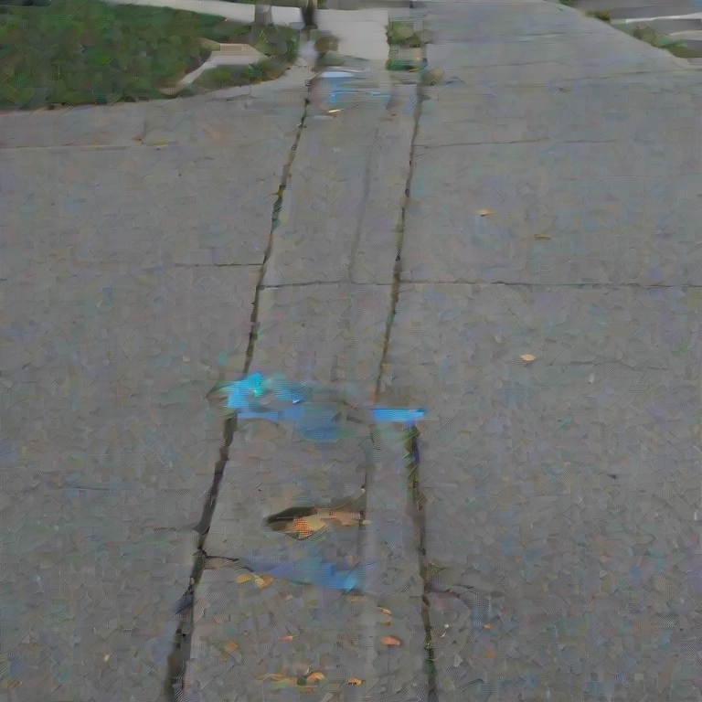
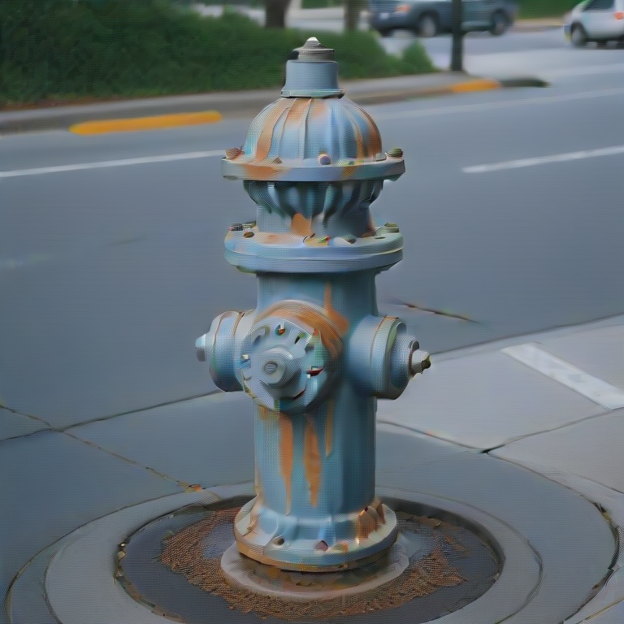
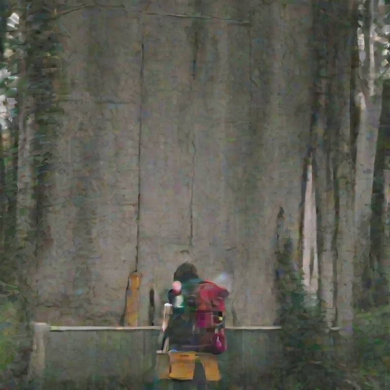
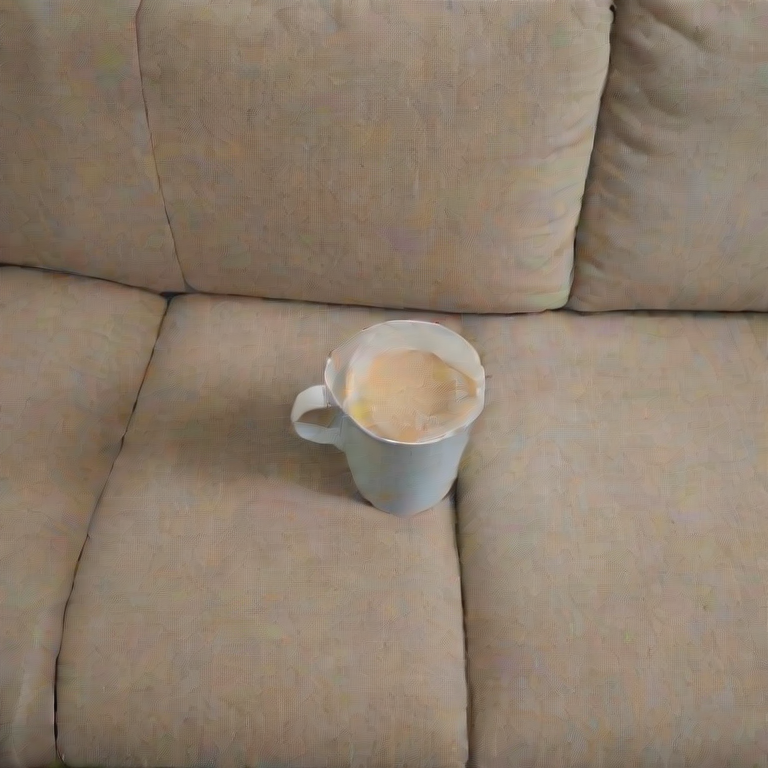
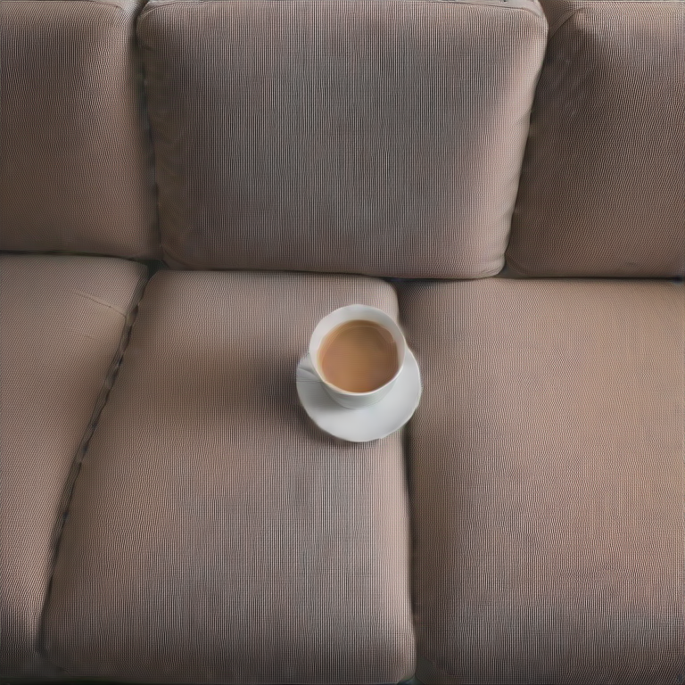

# Reproducing and Analyzing Zigzag Diffusion Sampling on DreamShaper-xl-v2-turbo

**Author:** Vlad Iftode (Group 14, lane: Z-Sampling + Experiment 8)
**Paper:** Bai et al., *Zigzag Diffusion Sampling: Diffusion Models can Self-Improve via Self-Reflection*, OpenReview `MKvQH1ekeY`.
**Upstream code:** `github.com/xie-lab-ml/zigzag-diffusion-sampling` at commit `513eb51cef223e7a562b5eb9b31d5ac5fa6b70f4`.

## 1. Introduction and motivation

Text-to-image diffusion models still misbehave on compositional prompts — wrong colors, miscounted objects, or scrambled spatial relations — even when the underlying model is otherwise strong. Two common remedies are (i) retraining or fine-tuning, which is expensive and tied to a specific dataset, and (ii) heavier classifier-free guidance, which trades alignment against image quality and tends to saturate quickly.

Zigzag Diffusion Sampling (Z-Sampling) takes a third route. Bai et al. propose a sampling-time procedure that interleaves a *denoising* step with a *DDIM inversion* step at a small inversion guidance, then continues. Because denoising and inversion use different guidance strengths, the "round trip" does not return to the same latent: it slightly amplifies the signal of the prompt while leaving most of the image content intact. The authors argue this acts as a form of self-reflection — the model uses its own conditional vector field twice and keeps the difference.

For me, the appeal is methodological. Z-Sampling is a single pure-inference change, with no extra parameters and no training. If the paper's claim holds, it should improve any diffusion checkpoint a downstream user already trusts, including the very fast distilled "turbo" models which only have 4 denoising steps to spend. My individual lane in Group 14 is exactly that stress test: can Z-Sampling still help on a 4-step turbo model where there is barely any room to add work, and does it survive the move off the paper's CUDA stack to an Apple Silicon environment? Experiment 8 in the group plan pairs Z-Sampling with `Lykon/dreamshaper-xl-v2-turbo` evaluated on a GenEval-style prompt subset.

### 1.1 Group context and individual scope

Group 14 has seven students, and the assignment matrix in `planning/role-assignments.md` divides four models (SD2.1, SDXL, Hunyuan-DiT, DreamShaper-xl-v2-turbo) across three datasets (Pick-a-Pic, DrawBench, GenEval) so that no two students share both a model and a dataset. Three sampling methods (standard, resampling, Z-Sampling) are split across `planning/experiment-division.md`: Eugen owns SD2.1 × Pick-a-Pic × Standard (Experiment 1); Daniel owns SDXL × DrawBench × Standard (Experiment 5); Gouri and Lenka share Resampling (Experiments 2 and 3) on DreamShaper-turbo × DrawBench and SDXL × Pick-a-Pic respectively; Radu and Bogdan hold the other two Z-Sampling cells. My cell is DreamShaper-xl-v2-turbo × GenEval × Z-Sampling (Experiment 8). The claims in this report are scoped to that single cell. I do not assert anything about the other students' results; the group-level cross-method comparison is the joint deliverable, not this individual report.

## 2. Method and approach

Standard DDIM sampling iterates `x_{t-1} = step(x_t, eps_theta(x_t, t; c, gamma))` for `T` decreasing timesteps, where `gamma` is the classifier-free guidance scale and `c` is the text embedding. Z-Sampling replaces the early portion of this loop with paired (zag, zig) rounds:

1. **Zag (denoise):** advance one timestep with guidance `gamma_1`.
2. **Zig (invert):** invert one timestep back with a low guidance `gamma_2` (here `0`), using the DDIM inverse scheduler on the same network.

After the first denoising step, the inverse/re-denoise pair is repeated `t_max` times per refined step, for the first `lambda_step` of the `T` total steps. Outside the refined window the loop reduces to standard DDIM. The implementation I used lives in `src/zigzag_project/zsampling.py`; it is a repo-local port of `utils/pipeline_stable_diffusion_xl.py::z_sampling_call` from the upstream commit above, kept outside the submodule because I had to update it to run on a modern diffusers stack.

For Experiment 8 I follow paper §4.1's DreamShaper-turbo settings exactly: `T=4`, `gamma_1=3.5`, `gamma_2=0`, `lambda_step=T-1=3` (zigzag the whole path), `t_max=1`. Pairs share an initial latent across sampling methods so any HPS difference is attributable to the sampler, not to the seed.

Three porting decisions are worth flagging. First, `retrieve_timesteps` is vendored from a newer `diffusers` release because the version pinned upstream (`0.22.3`) does not expose it as a public helper. Second, the MPS pin set is deliberately relaxed (`torch==2.12.0`, `diffusers==0.37.1`) because the upstream `torch==2.0.1` does not run SDXL inversion at acceptable speed on Apple Silicon. Third, the inversion scheduler's config must be cloned from the DDIM forward scheduler, not from the checkpoint's original scheduler config; an earlier draft had the order reversed, and a second latent-reset bug (`self.scheduler._step_index = None`) was needed to keep repeated denoise/invert/re-denoise calls aligned with the upstream loop. Both fixes were applied to `src/zigzag_project/models.py` and `src/zigzag_project/zsampling.py`, and re-running the top-win prompt (`geneval_259_colors`, seed 42) under the fixed code produces PNGs that are *bit-identical* to the committed images (MAE = 0.000, 100% pixel match), so the committed 108-image dataset stands.

## 3. Experiment setting

- **Model:** `Lykon/dreamshaper-xl-v2-turbo`, fp16, loaded via the project's `load_dreamshaper_xl_turbo` helper.
- **Hardware:** Apple M4 Max (arm64), MPS backend. No CUDA available.
- **Software:** Python 3.10.20; `torch==2.12.0`; `diffusers==0.37.1`; `transformers==5.8.1`; `hpsv2==1.2.0`; `pytest==7.2.0`. Upstream pins `torch==2.0.1`, `diffusers==0.22.3`, `transformers==4.41.0` on CUDA. I deliberately relaxed those pins because torch 2.0.1's MPS support is too weak for SDXL inversion; this divergence is treated as a reproducibility caveat throughout (see §5).
- **Prompts:** 18 prompts, the first three from each of the six GenEval tags (`single_object`, `two_object`, `counting`, `colors`, `position`, `color_attr`), as listed in `experiments/prompts/geneval_vlad_balanced.md`. The subset is intentionally tag-balanced rather than random so per-tag effects can be read off cleanly.
- **Seeds:** `42`, `123`, `2026`. Each `(prompt, seed)` produces one standard and one Z-Sampling image at 768x768.
- **Metrics:** HPSv2.1 (`hpsv2.score(..., hps_version="v2.1")`) per image, pairwise delta `Z - standard`, plus the official GenEval detector rules on the same 54 pairs. HPSv2 is a learned human-preference proxy; GenEval is the detector-grounded compositional metric used in the paper.
- **Provenance:** 54 paired generations are recorded with full hyperparameters and per-image runtime in `outputs/vlad_geneval/balanced_18x3/manifest.jsonl`; per-pair scores in `scores.jsonl`.

## 4. Results

### 4.1 Quantitative

The GenEval detector pass is the most important result because it checks object/count/color/position rules rather than pure preference. On the 54 paired images, standard sampling passes 17/54 pairs (31.5%) and Z-Sampling passes 27/54 pairs (50.0%), a +18.5 percentage-point detector gain. There are 10 Z-only detector wins, 0 standard-only detector wins, 17 both-pass pairs, and 27 neither-pass pairs.

| Tag | Pairs | Standard pass | Z pass | Detector delta |
| --- | ---: | ---: | ---: | ---: |
| color_attr | 9 | 0 | 0 | +0.0% |
| colors | 9 | 5 | 8 | +33.3% |
| counting | 9 | 2 | 5 | +33.3% |
| position | 9 | 0 | 1 | +11.1% |
| single_object | 9 | 9 | 9 | +0.0% |
| two_object | 9 | 1 | 4 | +33.3% |
| **overall** | **54** | **17** | **27** | **+18.5%** |

The detector result was produced locally on CPU after adapting `scripts/run_geneval_detector.py` to support the upstream-compatible `mmdet==2.28.2` output format; the detailed table is in `report/tables/vlad_geneval_detector.md`.

HPSv2.1 tells the same directional story but with a much stronger preference signal. Across the full 54-pair run, Z-Sampling wins 53 pairs and standard sampling wins 1, giving a 98.1% HPSv2.1 preference win rate and a mean HPSv2 delta of +0.0358 (min -0.0023, max +0.1090). The standard mean score is 0.217 and the Z mean is 0.253; both are modest in absolute HPSv2 terms but the relative gap is consistent. Per-tag 95% bootstrap confidence intervals on the delta (n=10000 resamples, rng seed 42) are reported below.

| Tag           | Pairs | Mean delta | 95% CI (boot)     | HPSv2.1 preference win rate |
| ---           | ---:  | ---:       | ---               | ---:                        |
| color_attr    | 9     | +0.0387    | [+0.0300, +0.0476]| 100.0%                      |
| colors        | 9     | +0.0577    | [+0.0405, +0.0759]| 100.0%                      |
| counting      | 9     | +0.0322    | [+0.0196, +0.0503]| 100.0%                      |
| position      | 9     | +0.0265    | [+0.0153, +0.0374]| 88.9%                       |
| single_object | 9     | +0.0222    | [+0.0171, +0.0267]| 100.0%                      |
| two_object    | 9     | +0.0373    | [+0.0293, +0.0466]| 100.0%                      |
| **overall**   | **54**| **+0.0358**|**[+0.0304, +0.0418]**| **98.1%**                |

*Win = higher HPSv2.1 score on the paired image. Not the GenEval detector score reported by Bai et al.*

Every per-tag confidence interval is strictly positive, including `position`. The earlier worry that the small subset could not resolve a per-tag effect is therefore not borne out by the bootstrap: at n=9 per tag the effect on position is small (+0.0265) but the 95% CI lower bound (+0.0153) is still well above zero. Prompt-level aggregation strengthens the same reading: Z-Sampling wins all three seeds for 17 of 18 prompts; the only prompt with a standard win is `geneval_355_position`, and that standard win is only 0.0023 HPS points. The largest mean prompt gain is the blue-fire-hydrant colors prompt (+0.0808); the smallest mean gain is the bench single-object prompt (+0.0151), where Z still wins all three seeds. The full prompt-level table is in `report/tables/vlad_prompt_level.md`.

The cost side of the trade-off is just as important. Standard sampling averages 6.16 s per pair (332.4 s total wall time on MPS) and Z-Sampling averages 13.80 s per pair (745.5 s total), a 2.24x slowdown. This is consistent with the algorithm's structure: each refined step performs one extra inverse pass plus a re-denoise of the same step, roughly doubling the network evaluations on the refined window. With `lambda_step=T-1`, that window is essentially the whole path.

I therefore ran the strongest Mac-feasible cost-control: regenerate the standard branch at 9 DDIM steps, using the same prompts, seeds, CFG scale, image size, and initial latent construction, then compare those 9-step standard images against the existing 4-step Z-Sampling images. The 9-step standard baseline is actually slower than Z-Sampling on this MPS run (18.14 s/image versus 13.80 s/image). It improves the standard mean HPS from 0.2168 to 0.2280, so the Z margin shrinks, but Z-Sampling still wins 42/54 pairs with mean delta +0.0245. The full cost-control table is in `report/tables/vlad_compute_matched.md`.

### 4.2 Qualitative

Three representative pairs are included as side-by-side figures: the two top Z-Sampling wins and the single Z-Sampling loss in the 54-pair run.

| Standard | Z-Sampling |
| --- | --- |
|  |  |

**Figure 1 — Top Z-Sampling win.** Prompt: "a photo of a blue fire hydrant" (colors, seed 42, delta +0.1090). Z-Sampling sharpens object focus and color saturation relative to the standard sample.

| Standard | Z-Sampling |
| --- | --- |
|  |  |

**Figure 2 — Second-highest Z-Sampling win.** Prompt: "a photo of two backpacks" (counting, seed 2026, delta +0.0947). Z-Sampling produces two distinctly drawn backpacks while the standard sample collapses one into a vague second shape.

| Standard | Z-Sampling |
| --- | --- |
|  |  |

**Figure 3 — Only Z-Sampling loss in the run.** Prompt: "a photo of a couch below a cup" (position, seed 42, delta -0.0023). The pair is essentially a tie under HPSv2; both samples place a cup above/on a couch, so the tiny standard edge should not be overread as a Z-Sampling spatial failure.

A short manual audit of the top wins and weakest edge cases is recorded in `report/tables/vlad_qualitative_audit.md`. It makes the result more nuanced than the 98.1% number alone: the largest wins are visually meaningful (blue hydrant and two backpacks), but the weakest gains often look like sharper renderings of still-ambiguous content (bench close-up; wine glass with no obvious kite). This is the concrete reason I treat HPSv2 as preference evidence rather than proof of GenEval-style compositional correctness.

### 4.3 Troubleshooting

Two practical issues are worth recording. First, `hpsv2==1.2.0` ships without the vendored OpenCLIP `bpe_simple_vocab_16e6.txt.gz`; I had to download it from the OpenAI CLIP repository into the package's site-packages path. Second, installing `hpsv2` downgraded `pytest` from 9.0.3 to 7.2.0 in my venv; the project's existing tests still pass at the older pytest, so I pinned the dev extra to that version to keep the environment internally consistent.

## 5. Interpretation and critical appraisal

The direction in §4 supports the paper's headline claim: Z-Sampling improves perceptual scores on a turbo SDXL checkpoint at small additional cost in code complexity. But several caveats temper how much can be read into "98.1%".

### 5.1 Metric mismatch is smaller now, but still matters

HPSv2.1 is *not* the GenEval metric Bai et al. report. HPSv2 is a learned human-preference proxy trained on ranking annotations and is dominated by aesthetic/photorealism signal; GenEval, by contrast, runs an object-detection pipeline against compositional rules ("does this image actually contain two backpacks?"). This matters because the two metrics have very different magnitudes here: HPS says Z wins 53/54 pairs, while GenEval says Z passes 27/54 and standard passes 17/54. The reassuring part is directional agreement: on all 10 pairs where the detector favors exactly one sampler, it favors Z, and HPS also favors Z. The caveat is scale: the detector result is a small balanced subset, not the full GenEval benchmark table.

### 5.2 Reward-hacking surface of HPSv2

HPSv2 is trained on human preference annotations that are known to correlate with saturation, contrast, and aesthetic sharpness (Wu et al., *Human Preference Score v2: A Solid Benchmark for Evaluating Human Preferences of Text-to-Image Synthesis*, 2023). Z-Sampling's mechanism — using the conditional vector field twice per refined step at asymmetric guidance — plausibly amplifies exactly those signals as a side effect of amplifying the prompt. The §4.2 wins are consistent with both readings: (a) genuinely better prompt alignment, and (b) higher saturation and edge contrast scoring better under HPSv2's preference prior. The GenEval detector pass reduces this concern because all one-sided detector wins favor Z, but it does not remove it: the detector subset is small, and HPS still has a larger magnitude than the detector pass-rate gain.

### 5.3 The position-tag dip is consistent with perceptual blindness, not "less headroom"

The lower delta on `position` (+0.0265) versus `colors` (+0.0577) initially invites the explanation that the position prompts are simply harder and leave less HPS headroom to gain. The data contradicts this. Position's *standard* mean HPS is 0.2319 — the second-highest of any tag, behind only `single_object` (0.2361), and well above `colors` (0.1967), `color_attr` (0.2247), `counting` (0.2235), and `two_object` (0.1878). If "less headroom on harder prompts" were the right story, the standard mean on position would be low, not nearly the highest in the run. The detector result supports the alternative explanation: position only improves from 0/9 to 1/9 detector passes, so HPSv2 is likely rewarding perceptual improvements more than spatial correctness on these prompts.

### 5.4 Cost is not free, but Z survives a 9-step standard baseline

A 2.24x runtime cost on a 4-step turbo model partly undoes the reason one picks a turbo model in the first place. More importantly, 13.80 s per Z-Sampling image on this hardware is in the range of a higher-step standard DDIM run. The paper does not report this exact turbo counterfactual, so I ran it locally with 9 standard steps. This makes the critique more precise: a stronger standard baseline does catch up somewhat (mean HPS rises by +0.0112 over 4-step standard), but it does not erase the Z-Sampling effect (42/54 HPS wins, +0.0245 mean delta). This result supports "Z-Sampling is more than just extra denoising steps" on this subset, while still showing that part of the original 4-step margin came from giving Z more computation.

### 5.5 Unclear parts of the paper

A few specifics had to be resolved by reading the upstream code rather than the paper. (i) The semantics of `lambda_step` are not pinned down in the paper; reading `utils/pipeline_stable_diffusion_xl.py` in the upstream repository shows it is the count of *refined* steps, so `lambda_step=T-1` zigzags steps `0..T-2` inclusive and leaves the final step as plain DDIM. (ii) The paper sketches the math of the inversion guidance gap `gamma_1 − gamma_2` but does not precisely pin how the asymmetric CFG terms are applied in `diffusers`' inverse scheduler in the presence of negative prompts; the upstream code resolves this by reusing the forward pipeline's CFG path with a separate config. (iii) The paper's headline table reports SDXL-base and SD2.1, not 4-step turbo variants; whether the claimed gains scale down to T=4 distilled checkpoints is exactly the question this experiment probes, and the answer on this subset is "yes" under both HPSv2 and the GenEval detector. (iv) The paper assumes a DDIM scheduler and does not study sensitivity to Euler / PNDM / DPM-Solver schedulers.

### 5.6 Environment divergence and MPS non-determinism

My run uses `torch==2.12.0` / `diffusers==0.37.1` on MPS; the paper's reference stack is `torch==2.0.1` / `diffusers==0.22.3` on CUDA. Numerical kernels, default schedulers, and fp16 behavior all differ across this gap, so my absolute HPS scores should not be cross-compared with upstream HPS scores at the third decimal. In addition, Apple Silicon fp16 kernels are not deterministic across runs in the strict bit-exact sense, so the committed manifest (`source_commit`, `upstream_commit`, all hyperparameters, seeds, package versions) enables *behavioral* reproduction of the statistical pattern, not pixel-identical reproduction. The bit-identical A/B verification mentioned in §2 is a same-process check at fixed code, not a cross-machine reproducibility claim.

### 5.7 Detector implementation caveat

The detector did run locally, but only after a compatibility correction. My first runner targeted the modern mmdet 3.x `DetDataSample` API; upstream GenEval actually asks users to install mmdetection 2.x, and the working Apple Silicon path uses `mmdet==2.28.2` plus a compiled Darwin `mmcv-full==1.7.2` extension. The final run forced `--device cpu` rather than MPS, because OpenMMLab detector ops are CPU/CUDA-oriented, not Metal-native. This is still the official GenEval rule logic and Mask2Former checkpoint, but it is a modernized wrapper around the upstream evaluator, not an untouched execution of `external/geneval/evaluation/evaluate_images.py`.

## 6. Conclusion

The headline finding I will keep from this experiment is the prompt/tag pattern, not the aggregate HPS win rate. On DreamShaper-xl-v2-turbo with 4 DDIM steps and `lambda_step=T-1`, Z-Sampling improves both metrics on this 18-prompt GenEval subset: +18.5 percentage points under the detector (27/54 vs 17/54) and +0.0358 mean HPSv2 with 53/54 HPS wins. The detector gains are strongest on `colors`, `counting`, and `two_object`, while `color_attr` remains unsolved for both samplers and `position` barely improves. The compute-matched check makes the result more credible but more modest: against a slower 9-step standard baseline, Z still wins 42/54 HPS pairs with +0.0245 mean delta, so the effect is not only "more steps", but the margin is smaller. The final claim for my lane should therefore be: Z-Sampling is useful for this turbo DreamShaper GenEval subset, especially on color/count/two-object prompts, but its gains are not uniform and must be reported with the runtime cost and small-subset caveat.
